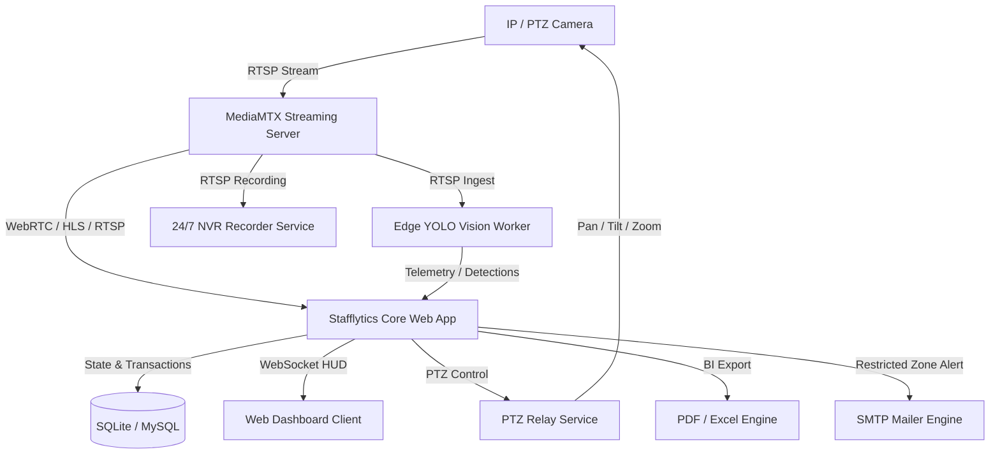

# Stafflytics AI | Business Intelligence & Edge Vision Suite

Stafflytics AI is an enterprise-grade, edge-accelerated business intelligence and video analytics platform engineered specifically for hospitality and restaurant environments. It combines high-performance computer vision, dual-factor biometric identification, real-time edge processing, automated attendance, and conversational AI analytics.

---

## 🎥 System Walkthrough

https://github.com/user-attachments/assets/0bb3425f-c55c-4938-8154-3b8c2b7f201c

*Live staff tracking, automated visual attendance, and executive reporting in action.*

---

## 🌟 Key Capabilities

### 👁️ Advanced Vision & Multi-Target Tracking
- **Multi-Model Inference**: Powered by YOLO11s with OpenVINO™ and ONNX Runtime acceleration.
- **Persistent Tracking**: ByteTrack coupled with an identity-centric Hungarian assignment algorithm to eliminate track fragmentation and identity swapping.
- **Dual Biometric Recognition**: Facial feature matching combined with 128-dimensional body appearance embeddings to maintain staff and customer identity persistence across occlusions.

### ⏱️ Automated Attendance & Labor Intelligence
- **Visual Clock-In / Clock-Out**: Frictionless attendance logged automatically via continuous biometric validation with anti-spoofing logic.
- **Productivity & Zone Analytics**: Real-time measurement of staff presence in authorized working zones (service floor, counter, kitchen) vs. idle zones.
- **Customer Proximity Tracking**: Detects staff-to-customer interactions and service response times.

### 📹 Edge Video Streaming & NVR Recording
- **Ultra Low-Latency Streaming**: MediaMTX RTSP/WebRTC (WHEP) and HLS streaming pipeline for live web dashboards.
- **24/7 Automated NVR Recorder**: Continuous hourly segmented video recording with disk quota enforcement (auto-pruning oldest archives).
- **PTZ Camera Control**: Real-time PTZ relay and preset patrolling via Imou Open Platform and ONVIF APIs.

### 🤖 Conversational AI & BI Reporting
- **Natural Language Chatbot**: Ask questions about daily attendance, customer traffic peaks, staff hours, and anomaly alerts.
- **Executive Reporting**: One-click generation of professional Daily and Weekly BI reports in PDF and Excel (.xlsx) formats.
- **Instant Security Alerts**: Automated SMTP email dispatch when unauthorized personnel enter restricted areas (kitchen, administrative office, cash register).

---

## 🏗️ System Architecture



---

## 🛠️ Technology Stack

| Layer | Technologies |
| :--- | :--- |
| **Backend Core** | Python 3.10+, Flask, Flask-Sock (WebSockets), Werkzeug |
| **Vision & AI** | Ultralytics YOLO11s, OpenVINO, ONNX Runtime, OpenCV, InsightFace / Face Recognition |
| **Streaming & Video** | MediaMTX, FFmpeg, RTSP, WebRTC (WHEP), HLS |
| **Databases** | SQLite3 (WAL mode) / MySQL (Enterprise support) |
| **Frontend UI** | HTML5, CSS3 Glassmorphism, Vanilla JS, Canvas HUD Overlay |
| **AI Analytics** | Google Gemini API (Chatbot Engine) |
| **Document Export** | ReportLab (PDF), OpenPyXL (Excel XLSX) |

---

## 📁 Repository Structure

```
stafflytics-ai-private/
├── app.py                      # Core Flask web application & WebSocket hub
├── vision_engine.py            # AI inference pipeline (YOLO + ByteTrack + Face/Body ReID)
├── identity_manager.py         # Hungarian assignment & persistent biometric matching
├── edge_ai_worker.py           # Standalone continuous edge YOLO inference worker
├── stream_manager.py           # MediaMTX & RTSP/HLS stream orchestration
├── ptz_relay.py                # PTZ camera control relay service
├── recorder_service.py         # 24/7 hourly video recording & disk quota service
├── chatbot_engine.py           # Conversational BI engine powered by Gemini
├── export_engine.py            # Executive PDF & Excel BI report generation
├── mailer.py                   # Automated SMTP email alert system
├── imou_client.py              # Imou Open Platform integration client
├── database.py                 # SQLite/MySQL database layer & schema migrations
├── schema.sql                  # Primary database schema
├── config.json                 # Core camera and database configuration
├── custom_bytetrack.yaml       # Tuned ByteTrack tracker configuration
├── requirements.txt            # Python dependencies
├── .env.example                # Sample environment variables configuration
│
├── bin/                        # Platform binaries (ffmpeg.exe, mediamtx.exe)
├── models/                     # Deep learning model weights & ONNX/OpenVINO models
├── static/                     # Web assets (CSS, JavaScript HUD, icons, branding)
├── templates/                  # Responsive HTML dashboard templates
│
├── start_all.bat               # One-click Windows startup script (MediaMTX, PTZ, NVR, App)
├── start_services.bat          # Streaming & recorder launcher
├── start_services_silent.vbs   # Silent background service launcher
├── run_edge_yolo.bat           # Continuous loop runner for Edge YOLO Worker
└── start_edge_yolo_silent.vbs  # Silent runner for Edge YOLO Worker
```

---

## 🚀 Getting Started

### 1. Prerequisites
- **Operating System**: Windows 10/11 or Linux (Ubuntu 20.04+)
- **Python**: Version 3.10 to 3.12 (64-bit)
- **C++ Build Tools**: Required on Windows for `dlib` compilation:
  - Install [Visual Studio C++ Build Tools](https://visualstudio.microsoft.com/visual-cpp-build-tools/) with the *Desktop development with C++* workload.

### 2. Installation
```bash
# Clone the repository
git clone https://github.com/minhajasghar/stafflytics-ai.git
cd stafflytics-ai

# Create and activate a virtual environment
python -m venv venv
# Windows:
venv\Scripts\activate
# Linux/macOS:
source venv/bin/activate

# Install required dependencies
pip install -r requirements.txt
```

### 3. Environment Configuration
Create a `.env` file from the provided `.env.example`:
```bash
copy .env.example .env
```
Key settings to configure in `.env`:
```env
# Optional Gemini API key for conversational BI chatbot
GEMINI_API_KEY=your_gemini_api_key

# Camera source mode and streaming configuration
CAMERA_SOURCE_MODE=remote_rtsp
REMOTE_RTSP_URL=rtsp://100.93.176.107:8554/cam
EDGE_PC_IP=100.93.176.107

# Web Application Port
STAFFLYTICS_PORT=5050

# Database Configuration (SQLite default; MySQL optional)
DB_TYPE=sqlite
```

---

## 💻 Running the System

### Option A: One-Click Startup (Windows)
Double-click `start_all.bat` or run from PowerShell:
```cmd
start_all.bat
```
This automatically orchestrates:
1. MediaMTX RTSP & WebRTC server
2. PTZ Relay service
3. 24/7 continuous video recorder service
4. Stafflytics core web application at `http://localhost:5050`

### Option B: Running Individual Services
- **Main Web Application**:
  ```bash
  python app.py
  ```
- **Edge AI Vision Worker**:
  ```bash
  run_edge_yolo.bat
  # Or directly:
  python edge_ai_worker.py --source rtsp://localhost:8554/cam --server http://localhost:5050 --fps 20
  ```
- **PTZ Relay Service**:
  ```bash
  python ptz_relay.py
  ```
- **24/7 Video Recorder**:
  ```bash
  python recorder_service.py
  ```

Access the dashboard at: **`http://localhost:5050`**

---

## 🔒 Security & Local-First Privacy
- **Local Biometric Processing**: All facial feature analysis, body embeddings, and detection inference are processed strictly on-premises on your local hardware.
- **Air-Gapped Ready**: Live video streams never leave the private network or edge environment.
- **Secure Sessions**: Permanent session management with parameterized database transactions across both SQLite and MySQL.

---

## 📄 License
Proprietary — All rights reserved © 2026 Stafflytics AI.
